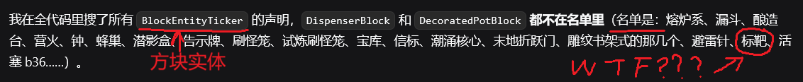

# Minecraft 原理探究

## 项目简介

这是一个探究 Minecraft（Java Edition）运行原理的小项目，未来笔者会在此发布一些基于 AI 阅读代码 + 人工复核润色的、剖析 Minecraft 运行原理的文章。反编译的版本为 1.21.4。

这个项目的起因是，笔者在设计机器过程中遇到了一些玄学的现象，也产生了对微观机制进行更细致了解的需求，同时 Minecraft 背后的运行原理本身也是令人感兴趣的，加之目前 AI Agent 的出现让代码理解难度降低了许多，于是笔者便开始着手做这个项目。

这个项目的目标，主要是针对不同主题进行深入的分析整理，以求服务于玩家的好奇心和实际的机器设计。对于每个主题，文章内容以笔者个人的研究路径为主，另外包含网络上的一些资料，不一定全面，不过会尽力包含笔者认为有价值的相关内容。

## 一些闲话

~~这才是你需要看的部分~~

笔者最近主要在开发新机器，~~而且笔者很懒~~，所以更新速度随缘，能更多久不烂尾纯凭运气喵qwq

实际上目前该项目只写了微时序部分和一些活塞，~~剩下的都是我画的大饼 AI 列的空架子~~，但是由于觉得应该对设计机器有帮助就发出来了awa

## 关于 AI for Tech MC

简而言之，如果你希望通过源代码来探究 Minecraft 的底层原理，那么 AI 就是你最好的助手，具体来说是 AI Agent。

首先 AI Agent 用起来并不麻烦。现在 DSH 都有桌面版了，配置是很容易的。然后再弄一份源代码给它就可以开始问问题了（实际上你准备好网络环境然后把 [MCP-Reborn](https://github.com/Hexeption/MCP-Reborn) 的链接丢给它，它应该是可以自己弄好源代码的）。

其次是 AI 的阅读效率比人类高很多。如果你真的手翻过反编译的源码，就会发现内部结构错综复杂，定位代码片段的工作比较琐碎。但是 AI 应该是经过了相关的训练，对项目的感觉很好，很容易就能找到需要的片段，也比较擅长联系上下文和相关代码文件。

最后是 AI 并没有那么不靠谱。AI 不靠谱的情况主要是在网页端 chat，它由于看不到代码容易瞎编。但是只要我们把源码接入 Agent 工作区，它的内容生成就几乎全是基于源码进行了，错误率能得到显著降低。

不过 AI 的幻觉问题依旧是无法解决的，正确性的复核仍然需要人来把关。

但是说实话，应该没人用 AI 做研究结果生成的内容自己都不看一眼吧，不然你搁这探究滚木呢（）

## 关于内容正确性

所有文章都会经过笔者对内容的复核及润色，尽力确保内容的正确性、易读性。但是请务必注意，由于笔者精力有限，无法复核 AI 所阅读的所有代码（~~不然还要 AI 干啥~~），笔者只能通过自己的游戏经验和对内容逻辑的检查来过滤潜在的错误。AI 出现幻觉、读错代码是完全可能的。如果你发现了有疑点的内容，请务必联系笔者进行进一步的人工确认，或者直接在评论区提出。
